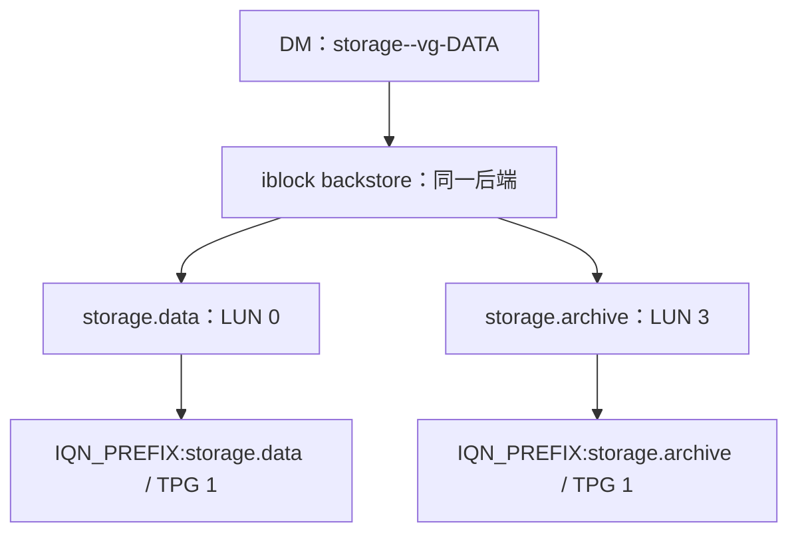

# openwrt lio-targetd 完整设计草案 v0.1

版本：v0.1（完整重组稿，取代本轮先前的同版本调度修订稿）  
日期：2026-10-19  
对象：PogoPlug V4 / 128 MiB RAM / OpenWrt 25.12.0 / Linux 6.12.71  
状态：整体业务与接口已展开；核心并发方案已确定，若干平台适配和业务策略待逐项冻结，尚未交付实现。  
用途：换页时可只携带本文件，直接继续自然语言编排和脚本实现讨论；原脚本与其他文档仅作追溯资料，不是理解本设计的前提。

阅读导航：业务目标与对象见第 2～3 节；运行基础与事件机制见第 4～7 节；配置与文件见第 8～9 节；前端筛选及并发交接见第 10～15 节；LIO 操作、脚本契约及生命周期见第 16～18 节；取舍、错误边界及下一步见第 19～25 节。

## 1．本文件的使用约定与决策状态

本文件独立说明系统目标、受管对象、配置格式、事件来源、调度协议、LIO 业务流程、脚本间接口、运行时文件及验证顺序。它不是对原脚本列修改任务，也不要求读者先读原脚本。

“完整”指把整体设计及未知边界展开，不表示所有实现细节都已经批准。全文按下列状态理解：

| 标识 | 含义 | 下一页如何使用 |
|---|---|---|
| 已确定 | 本轮反复讨论后确认的架构与约束 | 实现必须保持；如改变，应重新说明原因和影响 |
| 业务基线 | 已从提供的配置与业务材料明确还原的工作方式 | 本文已完整说明，不需要另读源脚本才能理解 |
| 建议 | 为使设计可实现而提出的首版组织方式 | 在相应脚本编排时确认，不能冒充已实现事实 |
| 待定 | 已知道必须回答，但本轮没有作最后决定的问题 | 从本文列明的输入、选择和约束继续讨论，不得默默补成代码 |

本轮最重要的已确定事项是：有事启动、做完退出；hotplug 先做便宜筛选再启动独立请求进程；请求进程等 G 后入队；非阻塞竞争 A；获胜者保持 A 并直接成为执行器；执行器连续收敛；退出时持有 G，先释放 A，再释放 G。

暂不扩展非阻塞消息箱、释放 A 后补查、空闲常驻轮询等替代协议。系统运行条件造成的不可控延迟也不列为本轮继续扩展设计的方向。

在明确发出“落地完整代码”之前，继续采用自然语言程序编排稿逐一讨论，不提前交付脚本代码。

## 2．系统要提供什么服务

系统把配置中选定的本地 LVM 逻辑卷，通过 Linux LIO 的 iblock 后端发布为 iSCSI LUN。它可以管理多个 iSCSI target，每个 target 有多个 LUN，按设备事件增量调整发布状态。

最小业务闭环是：

1. 设备由 OpenWrt 现有 LVM 机制激活，形成 DM 块设备。
2. 本方案接收设备事件，识别该设备是否受管。
3. 按 `.luns` 找到这个 DM 对应的所有发布条目。
4. 设备可用且条目为 on 时，保证后端绑定与 LUN 发布符合配置。
5. 设备不可用或条目为 off 时，撤销对应 LUN 映射；无引用的本方案后端可被清理。
6. 重复消息集中合并，业务操作幂等；处理完毕后编排进程退出。
7. 用户空间编排进程退出后，内核中的 LIO 对象继续工作，已有服务不依赖编排脚本常驻。

### 责任边界

| 责任 | 本方案是否承担 |
|---|---|
| 根据已有配置创建、校正、撤销 LIO 映射 | 承担 |
| 事件入队、唯一执行器、滤波、连续收敛与正常退出交接 | 承担 |
| 开机补齐已有设备，手工请求重新检查 | 承担 |
| 创建 PV/VG/LV，格式化文件系统 | 不承担 |
| 修改现有 LVM 自动激活入口 | 本版不承担 |
| 自动挂载发布卷上的文件系统，或启用其 swap | 不承担 |
| 创建网络地址、路由、防火墙策略 | 本版不承担；portal 所需地址由外部准备 |
| 为客户端管理 initiator 会话、数据库或文件系统 | 不承担 |
| 自动提供 CHAP 凭据、静态 ACL 管理 | 本轮尚未设计，不能从现有属性样例推导出已经具备 |
| 断电后持久队列、崩溃后自动重放、exactly-once 执行 | 未承诺 |

本机实验盘 `vg2/SWAP` 与 `vg2/USBROOT` 只证明识别与读取能力，不构成自动发布授权。下文配置示例采用虚构的数据 LV 名称。

## 3．受管对象、术语和命名关系

| 名称 | 在本方案中的含义 |
|---|---|
| LV | LVM 逻辑卷，激活后由 DM 提供块设备 |
| `dm-N` | 内核设备编号形式，例如 dm-1；用于定位本次事件，不作为持久业务名称 |
| DM_NAME | DM 映射名称，例如 `storage--vg-DATA`；对应 `/dev/mapper/<DM_NAME>` |
| DM_UUID | DM 的身份属性，可用于区分同名映射重建；是否纳入首版接口待定 |
| 配置名称 NAME | `.target` 与 `.luns` 共用的文件名主体，例如 `storage.data` |
| backstore | LIO 对后端块设备的对象，本方案使用 iblock |
| IQN | iSCSI target 名称；业务基线为 `<IQN_PREFIX>:<NAME>` |
| TPG | target portal group；现有样例为 1，对应 `tpgt_1` |
| portal | iSCSI 网络监听端点，例如 `0.0.0.0:3260` |
| LUN_ID | 某一 TPG 内的 LUN 编号；不同 target 可各自存在 LUN 0 |
| P | 生产者，即独立请求子进程；不是内核事件本身 |
| W | 执行器，即持有 A、集中完成业务的进程 |
| Q / R | 待处理队列 / 至少再评估一次入口的请求标记 |
| G / A | 短暂共享交接锁 / 唯一执行权锁 |

LVM 名称中的连字符可能在 DM_NAME 中采用转义形式；脚本应采用实际 DM 属性或明确解析结果，不自行猜测 VG/LV 名称如何拼接。

### 对象关系

一个 DM 的业务身份与一个 LUN 的编号不是同一概念。多个配置条目可以引用同一个 DM；同一 target 可以引用多个 DM。是否允许同一块存储由多个客户端同时写入，是配置与使用方的责任，调度器不会因此复制底层存储。



图中箭头表示业务引用关系。实际 configfs 中，是 LUN 目录内的 `data` 符号链接指向 backstore，而不是 backstore 内创建 LUN。

### 路径契约

| 对象 | 路径或计算规则 | 状态 |
|---|---|---|
| configfs 挂载根 | `/sys/kernel/config` | 本机已验证 |
| target 核心根 | `/sys/kernel/config/target/core` | 已验证 |
| iSCSI fabric 根 | `/sys/kernel/config/target/iscsi` | 已验证可创建 |
| iblock HBA | `/sys/kernel/config/target/core/iblock_0` | 业务基线命名；正式采用前核对是否由本方案独占 |
| DM backstore | `<HBA>/<DM_NAME>` | 业务基线 |
| 后端设备路径 | `/dev/mapper/<DM_NAME>` | 业务基线；与当前内核身份的核对方式待实现 |
| target | `<fabric>/<IQN_PREFIX>:<NAME>` | 业务基线 |
| TPG | `<target>/tpgt_<TPG>` | 首版样例为 1；字段支持范围待冻结 |
| portal | `<TPG>/np/<PORTAL>` | 单 portal 的业务基线 |
| LUN | `<TPG>/lun/lun_<LUN_ID>` | 业务基线 |
| LUN 后端链接 | `<LUN>/data` → `<HBA>/<DM_NAME>` | 业务基线 |

对象名称用于定位，不自动证明对象归本方案所有。正式实现必须明确 HBA、IQN 和对象命名空间的所有权；不得看到路径存在就重绑设备或删除未知对象。

## 4．已经验证的运行基础

以下为本页实机结果；部分是《SD卡启动实验成果 v0.1》形成之后新增的证据，不应误认为原文已包含全部结果。

| 项目 | 已有证据 |
|---|---|
| SD 自动启动 | 已打通 UBOOT → sd-init → FAT 上的 init → SquashFS 文件根层与 F2FS overlay → procd |
| PID 1 | `/sbin/procd` |
| LIO 内核能力 | TARGET_CORE、TCM_IBLOCK、ISCSI_TARGET 内建，configfs 可用 |
| USB 存储缺失原因 | USB 控制器与硬盘盒枚举正常，但接口未绑定 usb-storage；实际内核 USB_STORAGE 未启用 |
| 构建修订 | 顶层 `.config` 增加 `CONFIG_PACKAGE_kmod-usb-storage=y`，`make defconfig` 后保留；后续镜像中存储链路工作 |
| 外置磁盘 | `/dev/sda` 被识别为约 232.88 GiB 的整盘 LVM PV |
| LVM 读取 | pvs、vgs、lvs 只读查询均返回 0，读取到 vg2 及其两个 LV |
| LV 映射 | SWAP 为 512 MiB，USBROOT 为 8 GiB；dm 映射存在，ext4 与 swap 签名可读 |
| LIO 配置树操作 | 成功创建临时 iblock HBA、未绑定后端对象、iSCSI target、TPG、空 LUN |
| 属性读写与清理 | authentication 写入后读回 1，TPG enable 保持 0，临时对象清理返回 0 |

尚未验证真实 LV 绑定后的客户端发现、登录和数据读写。configfs 操作成功不等于完整 iSCSI 数据链路已通过。

### 与本服务直接相关的构建输入

OpenWrt 顶层至少需要表达 LVM 工具与 USB 存储的选择，由构建系统展开依赖：

```text
CONFIG_PACKAGE_lvm2=y
CONFIG_PACKAGE_kmod-usb-storage=y
```

内核新增能力采用已确认的内建方式：

```text
CONFIG_TARGET_CORE=y
CONFIG_TCM_IBLOCK=y
CONFIG_ISCSI_TARGET=y
```

CONFIGFS_FS 随 TARGET_CORE 选入。现有 SD 启动所需的 MMC、FAT、loop、SquashFS、F2FS、overlay 和 sd-init 已属于可工作基线，本方案不重做它们。

请求脚本和执行器所用的 flock、shell 内建及滤波工具，仍需在目标镜像核对实际能力，再决定是否增补工具包；不能因为构建主机具有某个选项就认定目标机也具备。上述片段不是完整 OpenWrt 设备配置，也不要求手工列出软件包依赖。

## 5．OpenWrt 中事件从哪里来

本机采用 procd 与 hotplug，不沿用原环境的 udev 规则引擎和 systemd 服务调度。

设备事件的大体路径为：内核 uevent 经 netlink 到 procd，由 hotplug 配置分发至 `/sbin/hotplug-call block`，再执行 `/etc/hotplug.d/block/` 下的脚本。

本机提供的 `hotplug-call` 内容表明：它遍历该类别目录，把每个文件放在单独的子 shell 中 source。目录脚本不是由各自声明的精确 DM 条件提前分发；筛选必须由脚本完成。脚本被 source，因此执行权限不是这一调用方式的必要条件。

上游 procd 的常规 exec 命令处理有排队机制；不能把“每次事件都后台启动请求进程”理解为没有成本：虽然 hotplug 很快返回，后台请求仍可能积累。我们通过前端筛选和短临界区降低这部分成本，不以后台化代替资源控制。

### LVM 有多个调用入口，不等于有多个独立通知体系

本机已发现：

| 入口 | 行为 |
|---|---|
| `/lib/preinit/80_lvm2` | 在启用条件满足时，于 preinit 中扫描并激活 LVM |
| `/etc/init.d/lvm2`、`S15lvm2` | 常规启动阶段扫描并激活 LVM |
| `/etc/hotplug.d/block/20-lvm2` | block add 时，针对事件设备运行 vgscan、vgchange |

日志证明 preinit 入口执行过，也证明 S15 找到 vg2 并报告两个 LV active；这些证据不能唯一确定首次激活由谁完成。再次请求激活也不等于必然新增一次相同的设备状态变化。

本方案消费 DM 设备事件，不代替上述 LVM 激活职责，也不修改这些已有入口。`20-lvm2` 的同步命令本身可能占用 hotplug 调用时间；本方案只能控制自己新增的处理成本。

## 6．“特定 LUN 触发”的准确含义

原规则实际匹配 `SUBSYSTEM=block`、`KERNEL=dm-*` 与特定 `DM_NAME`。因此触发源是 **LUN 的后端 LV／DM 块设备变化**，不是某个 LIO LUN 自身的独立业务通知。

DM 对应哪个 target、哪个 LUN，由 `.luns` 配置决定。一个 DM 事件不必只影响一个 LUN。

| 环节 | 原 udev 方式 | 本方案 hotplug 方式 |
|---|---|---|
| 事件接收后 | udev 规则引擎判断 | block 类别脚本进入后判断 |
| DM 身份 | 前序规则可准备 DM_NAME、DM_UUID 等属性 | 需要根据事件及设备属性自行取得 |
| 不匹配 | 不执行业务 RUN | hotplug 脚本直接返回 |
| 匹配 | 调用 queue-update | 启动独立请求子进程 |

这不要求全扫描。事件已经指出本次设备，读取对应的 `dm/name` 是对单个设备的定点读取，不是运行 `lvm lvs` 或遍历所有磁盘。

remove 时设备属性可能已消失，不能假定仍能读取 sysfs，也不能假定 OpenWrt 事件天然携带 udev 补充的 DM_NAME。该身份接口留待实机取证后确定，见“下一页必须明确、但尚未冻结的接口”章节。

## 7．完整的运行结构

系统分为事件入口、请求提交、集中执行和启动补齐四个部分：

| 部分 | 输入 | 主要动作 | 输出 |
|---|---|---|---|
| hotplug | 本次 block 事件 | 便宜筛选、取得足够的事件身份、后台派发 | 一个独立请求进程或直接忽略 |
| 请求进程 P | 标准化前后的事件参数 | 等 G、写 Q/R、非阻塞取 A | 入队后退出，或持 A 转为 W |
| 执行器 W | 继承的 A、队列批次、配置、设备现实 | 合并、收敛、固定滤波、再检查 | 内核 LIO 对象与最终结果 |
| init/手工入口 | 开机或管理员重新检查请求 | 组织受管设备的初始/重查请求 | 复用同一生产者协议 |

没有单独的常驻 broker，没有定期扫描 pending 的空闲进程，没有按轮次启动 timer。固定滤波属于执行器当前活动周期的一部分，活动期间持续持 A；它可以 sleep，但不在无请求时永久驻留。

执行器每轮只处理移交批次涉及的设备；初始启动与配置重查可以组织一批受管设备请求，但不把所有热插拔事件都升级为全盘扫描。

同一 DM 在一批请求中可能出现多次，合并与配置解析在 G 外完成。按设备的合并方式、是否依赖事件序号及现实状态校正，见后文业务裁决与待定接口。

## 8．配置文件的完整组织与字段

配置根目录是 `/etc/lio-targetd/`，采用简单文本格式。首版不同时引入 UCI 配置转换。配置描述管理意图，运行时队列与锁不写入此目录。

### 全局 settings.conf

路径：`/etc/lio-targetd/settings.conf`。

| 拟定字段 | 含义 | 草案参考值 | 状态 |
|---|---|---|---|
| ENABLED | 是否允许本方案接受并执行发布编排 | 1 | 全局开关需求已提出；名字与生效流程待定 |
| DEBOUNCE_MS | 每轮处理后的固定滤波时间 | 2000 | 固定滤波已确定；单位、可接受精度待工具验证 |
| LOG_LEVEL | 正常日志详细程度 | info | 建议 |

字段样式示意：

```ini
ENABLED=1
DEBOUNCE_MS=2000
LOG_LEVEL=info
```

这里是配置文本，不是待执行的 shell 命令。解析器不应为了读取字段执行任意 shell 内容。是否支持引号、行尾注释、重复键等，必须在配置编排中一次定义并保持一致。

ENABLED=0 应抑制哪些入口、正在运行的一轮怎样结束、是否撤销已发布对象，尚未确定。不能直接把“禁用编排”解释为“立即撤销服务”。

G/A 路径、队列格式、描述符编号、configfs 对象路径计算规则属于内部协作契约，不建议变成可以随意改动的用户参数。

### 每个 target 的 .target

文件对示例：

- `/etc/lio-targetd/storage.data.target`
- `/etc/lio-targetd/storage.data.luns`

两者主体 NAME 都是 `storage.data`。业务基线以 `.luns` 中的发布条目驱动 target 的使用；只有空 `.target` 时是否预先创建空 target，本版没有额外要求。

参考配置：

```ini
IQN_PREFIX="iqn.2026-10.local.pogov4"
TPG=1
PORTAL="0.0.0.0:3260"
ATTR_generate_node_acls="1"
ATTR_cache_dynamic_acls="1"
ATTR_authentication="0"
ATTR_demo_mode_discovery="1"
ATTR_demo_mode_write_protect="0"
ATTR_tpg_enabled_sendtargets="1"
```

此例仅展示字段与现有业务材料的形式，不代表已经完成网络访问策略或认证方案审批。

| 字段 | 业务语义与本版边界 |
|---|---|
| IQN_PREFIX | 与 NAME 用冒号连接，例中生成 `iqn.2026-10.local.pogov4:storage.data` |
| TPG | 目标 TPG 编号。样例为 1；不能读取后忽略。首版只接受 1，还是完整参数化各路径，待定 |
| PORTAL | 单个监听端点。现有业务为单 portal；空值、IPv6 和多 portal 的支持范围待定 |
| ATTR_generate_node_acls | 映射到 TPG attrib 同名属性，用于动态生成节点 ACL 的模式 |
| ATTR_cache_dynamic_acls | 映射到 TPG attrib 同名属性，控制动态 ACL 缓存行为 |
| ATTR_authentication | 映射到 TPG attrib 同名属性；例中为 0，没有另配 CHAP 凭据 |
| ATTR_demo_mode_discovery | 映射到 TPG attrib 同名属性 |
| ATTR_demo_mode_write_protect | 映射到 TPG attrib 同名属性；值 0 不能解释为开启写保护 |
| ATTR_tpg_enabled_sendtargets | 映射到 TPG attrib 同名属性 |
| 其他 ATTR_* | 是否允许任意映射或采用受支持列表，待配置编排冻结；属性不存在不能假装写入成功 |

TPG 属性与具体 LUN 的访问模式共同影响实际访问行为，不能仅凭 `.luns` 中写了 rw，就认定客户端一定可写。

### 每个 target 的 .luns

每条有效记录包含四列，业务基线为按空白分隔，忽略空行与注释行：

```text
# LUN_ID  DM_NAME              ACCESS  ADMIN_STATE
0         storage--vg-DATA     rw      on
1         storage--vg-ARCHIVE  ro      on
2         storage--vg-SPARE    rw      off
```

| 列 | 意义 |
|---|---|
| LUN_ID | 该 target/TPG 内的 LUN 编号，不是 dm-N 的编号 |
| DM_NAME | 后端映射的实际 DM 名称；业务匹配为准确名称，不能把前端的通配筛选规则自动当成 LUN 展开规则 |
| ACCESS | ro 或 rw，表示该发布条目的访问意图 |
| ADMIN_STATE | on 或 off。on 还需设备可用才能发布；off 不发布该条目 |

所有列都必须有清晰的有效值约束。重复 LUN_ID、无效编号、缺列、非法状态不能静默选择一条继续操作；错误隔离范围与返回结果在实现编排中确定。

同一 DM 可出现在多个文件中，对应多个发布条目。共享一个 backstore 时，不同条目的 ro/rw 如何正确实现，尤其不能通过把整个共享后端设为只读来无意改变其他 rw 发布。**首版 ACCESS 的实现层与不支持组合的拒绝方式待定，不能默默降为 rw。**

off 的最小语义是撤销该条目引用，不等于删除 LV，也不等于禁用同一 DM 的其他 on 条目。

### 配置读取与生效

执行器在 G 外读取配置，形成当前处理所需的策略。不能因每条事件进入 hotplug 就遍历全部 `.luns`。

配置更新完成后，通过统一重查入口请求执行器再次评估；普通文件修改不天然等于 DM 设备事件。每轮读取还是每个活动周期读取、如何避免读取到半套更新，是待定接口，不能假定配置文件变更会自动触发发布。

配置中消失的条目、改名的 IQN、改动的 portal，需要结合已发布对象处理；只读取“新配置还存在的条目”不足以清理旧对象。这一责任已明确，具体所有权记录方式待定。

## 9．文件落点与职责

### 脚本文件：四个入口

| 文件 | 责任 | 生命周期 |
|---|---|---|
| `/etc/hotplug.d/block/80-lio-targetd` | 轻量筛选、提取参数、启动请求进程 | 快速返回 |
| `/usr/libexec/iscsi-luns-queue-update` | 等 G、入队、设置 R、非阻塞取 A | 多数退出，获胜者 exec 执行器 |
| `/usr/libexec/lio-targetd` | 接收已取得的 A，执行收敛循环及退出交接 | 有事运行，clean 后退出 |
| `/etc/init.d/lio-targetd` | 开机初始检查、手工重新检查、配置更新后的请求入口 | 提交后返回 |

执行器不是独立的第二套启动入口。手工请求也应经过统一生产者协议。四个入口不代表四个常驻进程。

init 的必要原因是：安装或启用脚本前设备可能已经出现，不能等待未来必然再来一次 add。开机入口应为受管设备提交初始检查，复用同一入队及执行权竞争机制，不直接并行操作 LIO。

不要求前端解析配置的每个事件都走开机流程；启动补齐与热插拔事件是两种来源、同一种交接协议。

### 配置文件：三类

| 文件 | 内容 |
|---|---|
| `/etc/lio-targetd/settings.conf` | 全局开关、固定滤波时间、日志级别等 |
| `/etc/lio-targetd/<名称>.target` | IQN、portal、TPG 及其属性 |
| `/etc/lio-targetd/<名称>.luns` | LUN_ID、DM_NAME、ACCESS、ADMIN_STATE |

同名 .target 与 .luns 配对，延续现有多个 target、每个 target 多个 LUN 的组织。首版不同时引入 UCI 转换。

锁路径、队列格式、描述符约定是内部协作契约，不做成任意用户可改的运行参数。配置中声明的 ro/rw、TPG 等字段，必须实际执行或明确拒绝，不能默默忽略。

现有配置的 IQN_PREFIX、文件名后缀组装规则等细节，应在配置脚本编排时逐项明确。示例配置和 udev 规则里的业务名称不等于本机 vg2 实验盘可直接投入发布。

### 运行时文件

统一根目录建议为 `/tmp/lio-targetd/`。

| 路径 | 内容与所有者 |
|---|---|
| `handoff.lock` | G，由生产者与执行器共同使用 |
| `active.lock` | A，由获胜生产者连续移交给执行器 |
| `queue` | 待移交事件，生产者追加，执行器移交 |
| `request` | R，生产者设置，执行器在 G 内消费 |
| `batch` | 当前执行器独占的本轮队列快照 |
| `devices/`（待定） | 如确有需要，保存 remove 所需的设备身份对应关系 |

队列拟保留每行 `<DM_NAME> <FOLDED_ACTION>` 的方向；是否需要附带 SEQNUM、DM_UUID、设备号，须结合事件顺序与身份方案确定，不能把这行格式视为最终已冻结接口。

运行目录按需创建。init 被再次调用时不能清空已有 queue、request、batch；不能为了“初始化”截断正在使用的锁及业务状态。

锁文件存在不表示锁忙。正常运行期间不删除或替换锁文件，否则可能出现不同进程锁住不同文件对象的情况。

日志优先进入系统日志，不预设一份持续增长的私有磁盘日志；高频正常事件不必逐步骤输出重日志。

### configfs 是内核业务对象，不是普通运行时队列文件

`/sys/kernel/config/target/` 下的 iblock、iSCSI target、TPG、LUN 等由执行器统一操作。它们在用户空间执行器退出后仍可继续存在并提供服务。

因此“执行器做完退出”不会自动撤销已经发布的 LUN。“停止编排”“停止接受新请求”“删除已发布对象”是不同业务；init stop 的具体含义留待明确，不能默认等同于清空 configfs。

### OpenWrt 构建中的映射

镜像内的四个脚本及 `/etc/lio-targetd/` 配置，通过源码树 `files/` 中对应路径注入。`/tmp/lio-targetd/` 的状态由运行时生成，不预装队列和锁状态。

本机使用完整 Buildroot。沿用已确认的 USB 存储与 LIO 构建输入；本轮不重新设计内核包或精简早期 initramfs。

## 10．前端筛选放在哪里，以及为何这样选择

本轮最后确定：**把便宜且能挡住无关事件的筛选放到 hotplug 内，通过后再创建请求子进程。**

| 位置 | 不匹配事件的成本 | 匹配事件的成本 |
|---|---|---|
| hotplug 内判断 | 判断后返回，不创建请求子进程 | 判断后创建子进程 |
| 子进程内判断 | 先创建子进程，再判断并退出 | 创建子进程后判断并继续 |

同样几条判断本身计算量近似；差别是是否为无关事件创建进程。如果所有事件都匹配，差别很小；无关事件较多时，提前筛选可减少进程启动和瞬间内存占用。未测量具体节省值，不给出毫秒或 KiB 的虚构数字。

| 操作 | 放置建议 |
|---|---|
| ACTION 判断、`dm-*` 匹配 | hotplug |
| 对本次设备读取一个明确身份属性 | 在可行时放 hotplug |
| 少量固定名称或模式比较 | hotplug |
| 遍历全部 .luns、完整策略解析、设备扫描 | 独立进程或执行器，且放 G 外 |
| 等待 G | 独立请求子进程 |

简单比较和读取优先使用 shell 内建，不为几条筛选连续调用 cat、grep、awk。不得为了精确筛选又把全量扫描塞回 procd 调用路径。

筛选能力可以接近原 udev 规则，但身份准备方式不同。名称或模式从何而来、如何与 `.luns` 保持一致，尚需确定。不得在多个脚本里各维护一份独立的业务设备名单。

## 11．需要修补的最后一条事件漏洞

设生产者为 P，执行器为 W，A 为活动锁，Q 为队列，R 为请求标记。若队列判断与释放执行权没有共同交接约束，就可能出现：

| 顺序 | 执行器 W | 生产者 P |
|---|---|---|
| 1 | 看到 Q 空、R 无，决定退出，但仍持有 A | |
| 2 | | 追加事件并设置 R |
| 3 | | 尝试 A，发现忙，认为现有 W 会接手，退出 |
| 4 | 释放 A，退出 | |
| 结果 | 没有执行器 | Q、R 仍有待处理请求 |

**最后一刻到达的一条事件就足以触发它，不需要大量并发。**

延长滤波、增加一次释放 A 之前的检查、让某个等待窗口“尽量大于”另一个窗口，都不能构成交接保证：新事件仍可能落在最后一次检查之后、释放 A 之前。必须消除责任判定的空隙，而不是调整窗口长短。

另外，分别在无锁条件下读取 Q 与 R，可能得到跨时刻的混合观察；最终裁决必须在同一交接临界区内完成。

## 12．只使用两把锁

| 名称 | 路径 | 职责 |
|---|---|---|
| G：共享交接锁 | `/tmp/lio-targetd/handoff.lock` | 串行化入队、请求标记、批次移交、执行权取得与退出交接 |
| A：执行权锁 | `/tmp/lio-targetd/active.lock` | 保证唯一执行器，覆盖已取得执行权到完成退出交接的全过程 |

G 兼任队列锁与退出交接锁，不再另设 request 锁、bootstrap 锁或 exit-gate 锁。

R 只是“至少还需要一次入口评估”的信号，不表示有人承诺启动、不表示已建立下一位执行器。A 忙必须来自实际的锁竞争结果，不能来自普通文件是否存在、PID 文件或异步启动请求的存在。

### 锁的顺序约束

生产者先取得 G，再**非阻塞**尝试 A。执行器长期持有 A，只在短暂交接阶段取得 G。

两者能共存的关键是：**生产者持有 G 时，绝不能阻塞等待 A。** 否则会产生 P 持有 G 等 A、W 持有 A 等 G 的死锁。

G 内禁止设备扫描、LIO 操作、固定滤波、全队列排序解析，以及等待另一个需要 G 的进程完成启动。

## 13．hotplug、短命子进程与执行器如何协作

### hotplug 的同步部分

1. 判断动作是否支持、设备是否为 DM。
2. 在身份信息可取得的条件下，做有限的名称或模式筛选。
3. 把本次事件参数传给独立请求子进程。
4. 返回，让 hotplug 分发继续推进。

hotplug 不等待 G，不等待业务完成。请求进程要正确处理标准输入输出及无关描述符，不因继承调用链资源而拖住返回路径；具体后台启动方式在实现时核对。

### 请求子进程的三个连续阶段

| 阶段 | 工作 | 不应做的工作 |
|---|---|---|
| 等待 | 携带事件参数，阻塞等待 G | 初始化完整业务、扫描设备、轮询 sleep |
| 入队 | 在 G 内追加 Q、设置 R、非阻塞竞争 A | 等待 A、操作 LIO |
| 执行或退出 | A 忙则退出；获得 A 则转成执行器 | 为每个事件另启完整业务进程 |

“用于等待的子进程”就是请求脚本本身，不增加一个专用等待脚本。等待锁采用阻塞等待的思路，不用循环反复尝试锁。

轻量化目标包括：等待前只准备必要参数，尽量采用 shell 内建；A 忙且入队成功后立即退出。shell 调用外部锁工具可能在等待期间占用不止一个进程，真实进程数与内存须在目标工具选型后测量，不能预先宣称一个请求永远只有一个进程。

### 成功入队后竞争 A

生产者持有 G 完成：

1. 追加一条请求到 Q。
2. 设置 R。
3. 非阻塞尝试取得 A。
4. A 忙：释放 G，退出。
5. 取得 A：保持 A，释放 G，转入执行器。

**取得 A 的生产者直接成为执行器。** 分成两个脚本是职责组织，不必增加另一个进程；建议通过 `exec` 替换自身程序，并完整继承已锁定的 A 描述符。

A 不能先释放，再让执行器重新取得；否则重新引入启动空隙。普通“探测 A 空闲”也不能代替真正取得 A。

生产者由此完成的是请求提交，而不是各自完成一遍 LIO 业务。队列保存多数短命子进程退出后尚未处理的工作。

## 14．执行器的入口、批次与退出

### 入口裁决

执行器始终持有 A，在 G 内读取 Q、R，并确认本地没有未完成批次：

| Q | R | 动作 |
|---|---|---|
| 空 | 无 | 没有本地未完成工作时，执行退出交接 |
| 空 | 有 | 消费本次 R，进行空轮与固定滤波，再回入口 |
| 非空 | 任意 | 移交本轮队列快照，消费相应 R，释放 G 后处理 |

R 的消费必须在 G 内、与本轮入口或快照移交一起进行。不能在业务处理完成后无锁清除 R，否则可能抹掉处理期间新到达的请求。

### 批次移交

为避免 G 的持有时间随队列解析成本增长，G 内只做队列到本轮 `batch` 的移交；可以采用同一临时文件系统内的重命名方式。排序、去重、配置解析及设备判断放到 G 外。

生产者必须取得 G 后才打开当时的 Q 进行追加，不能长期保留已被移交的队列写入描述符。新事件进入新的 Q，不进入执行器独占的 batch。

batch 是执行中的队列快照，不是本轮暂停讨论的非阻塞消息箱方案。正常路径只有一个 batch 消费者，未处理完不得覆盖或宣称 clean。异常遗留 batch 如何处理见“下一页必须明确、但尚未冻结的接口”章节，尚未承诺自动重放。

### G 外业务

按本轮请求合并 DM，读取配置与设备现实状态，幂等创建、更新或删除所需 LIO 对象。完成本轮后固定等待滤波窗口，再回入口。

动作折叠保留原设计方向：remove 折叠为 remove；add/change/bind/move 折叠为 add；其他动作忽略。原始动作与设备可用性不应混为一谈，DM add 本身不保证映射已完全就绪。

异步子进程的执行先后也不天然等于内核事件顺序。同一 DM 的“最后一条”如何定义、如何结合实际状态，必须在实现编排时明确，不能把最后入队的一条无条件等同于最新设备事实。

### 唯一退出交接

确认无剩余工作后，严格执行：

1. 保持 G。
2. 释放 A，结束当前执行权。
3. 释放 G。
4. 退出；不再修改队列、请求标记、批次或 LIO 业务对象。

**必须先释放 A，再释放 G。** A 不能拖到释放 G 后的 EXIT 清理才释放。

EXIT 清理必须知道本进程是否仍拥有锁及其描述符，不能误解锁其他执行器。交接之后若输出日志，不得再作共享业务裁决；较长的日志操作也不应占据 G。

## 15．正常并发时序矩阵

下表按 G 临界区的先后顺序枚举主要交接情形。G 使这些关键操作串行化，不必为临界区内部每条普通指令排列所有组合。

| 情形 | G 下的顺序 | 结果 |
|---|---|---|
| A 空闲，单一请求 | P 入队并取得 A | P 转为执行器 |
| A 空闲，多个请求 | 第一个 P 取得 A；后续 P 依次入队，看到 A 忙 | 唯一执行器处理后续队列 |
| W 正在执行业务 | P 入队，看到 A 忙 | P 退出，W 下轮取队列 |
| W 正在滤波 | P 入队，看到 A 忙 | P 退出，滤波后 W 再检查 |
| P 先于退出检查取得 G | P 入队后退出；W 再取得 G | W 看到工作，取消退出 |
| W 先取得 G，确认 clean | W 在 G 内释放 A，然后释放 G；P 才能入队 | P 取得 A，成为下一位执行器 |
| W 已释放 A，但尚未释放 G | P 只能等 G，尚不能执行“入队后看到 A 忙”的判断 | G 释放后 P 取得 A |
| W 移交批次时有新事件 | P 等 G；移交完成后向新 Q 写入 | 本轮 batch 与下轮 Q 不混写 |
| 最后一条事件的子进程尚在等 G | 请求仍由该子进程携带；获 G 后完成入队与 A 竞争 | 按上述两种交接归属处理 |
| 多个 P 在 W 退出附近到达 | G 排出先后，首位获 A，其他入队后退出 | 不需要额外 bootstrap 锁 |

其核心保证是：

> 每条成功入队的工作，要么由仍持有 A 的执行器在后续入口检查中发现，要么由生产者在 G 内取得 A 后负责执行。

“A 空闲时负责建立下一次执行”指生产者取得执行权并转为执行器，不是生产者自己反复检查一遍就算完成。

### 为什么不能先解 G，再解 A

若 W 在确认 clean 后先释放 G，P 就可能在 A 仍忙时入队并退出；W 随后释放 A，原漏洞立即恢复。因此释放顺序属于协议本身，不是代码风格选择。

### 为什么不能继续依赖异步服务启动

发出启动请求不等于执行器已取得 A；服务管理器也未必把正在结束的同一任务上的重复启动解释为独立后续执行。本方案用“生产者真正取得 A 并原地转为执行器”避免该不确定交接。

## 16．LIO 的业务裁决与实际对象操作

调度协议回答谁负责处理，下面回答执行器处理什么。所有设备查询、配置解析和 configfs 业务操作都在 G 外、持有 A 时完成。

### 基本发布条件

每条 `.luns` 记录的期望状态由配置和设备现实共同决定：

| 当前设备判断 | ADMIN_STATE | 期望 LUN 状态 |
|---|---|---|
| 可用 | on | 存在，指向正确后端，并落实 ACCESS |
| 可用 | off | 该条目不存在 |
| 不可用 | on | 该条目不存在，等待后续设备事件或显式重查 |
| 不可用 | off | 该条目不存在 |
| 身份或可用性尚不确定 | 任意 | 不能把不确定伪装为已确认可用或已确认消失；处理策略待定 |

设备存在不等于文件系统已挂载，也不等于该卷适合发布；本方案只检查编排所需的块设备条件，不自动挂载、格式化或接管卷内数据。

### 事件事实与现实状态

Q 中的动作是触发线索，不是配置命令。add/change 不能强制把当前已不存在的设备变成可用；DM add 时也可能只是分配了设备号，映射尚未就绪。

已提供的业务基线采用“remove 直接判 absent，其他折叠 add 再检查存在”的方式，批次中同名 DM 取最后记录。本方案增加独立请求进程后，入队先后不必等于内核事件发生先后，因此这部分需要明确选择：

| 选择 | 作用与限制 | 状态 |
|---|---|---|
| 仅按入队最后动作 | 简单，但可能把晚执行的旧事件当成新事实 | 不能未经分析照搬 |
| 按内核事件序号定义先后 | 可用于整理同源事件；开机/手工请求也需定义比较规则 | 候选，待定 |
| 事件提示受影响 DM，执行时复核当前状态 | 更接近期望状态收敛；仍需处理尚未就绪和同名重建 | 候选，待定 |

最终实现必须消化这个问题，但它不要求增加第三把调度锁，也不推翻已确认的 G/A 责任交接。

### 准备 configfs 与 HBA

1. 检查 `/sys/kernel/config` 的实际挂载类型；已挂载 configfs 则复用。
2. 未挂载且路径可用时挂载；若被其他文件系统占用则报告失败。
3. 检查 `target/core` 与 iSCSI fabric 能力。内建功能不应因 `modprobe` 找不到单独模块文件而被误判不可用。
4. 按确定的所有权规则建立或复用 iblock HBA。

不能把 configfs 当成普通磁盘目录树随意递归创建或删除；对象创建必须遵守内核接口。环境准备失败时，不能继续假装本轮 LUN 已发布。

### 设备可用且存在 on 条目

以 DM=`storage--vg-DATA`、NAME=`storage.data`、LUN_ID=0 为例：

1. 确认本次设备身份及后端块设备路径。
2. 查找 `<HBA>/storage--vg-DATA` 后端。
3. 后端不存在时创建，设置需要的 alias，通过 control 绑定后端路径，并启用。
4. 后端已存在时验证是否与当前设备及预期属性一致；已经绑定的后端不能重复盲写绑定入口，也不能因名称相同就认定内容正确。
5. 按 `.target` 得出完整 IQN，建立或复用 target、TPG、portal，应用支持的属性。
6. 建立或校正 `lun_0/data` 到该 backstore 的链接，落实 ACCESS。
7. 保证所需的 TPG 启用状态，记录实际成功或失败。

具体启用顺序、已有会话时哪些属性可改、冲突对象是否允许替换，需要在执行器编排中确定。本草案不把原脚本的调用顺序自动视为已经实机验证的最佳顺序。

若一个 DM 命中多个发布条目，后端可共享；每个 target 的公共外壳在一轮内不必为每条 LUN 重复解析或初始化。缓存限于本轮或明确的活动周期，不使用无限增长的常驻状态。

### 对象已经正确存在：幂等处理

重复 add/change、重复开机检查或同一批多条消息，不应创建第二份同名对象。

| 已有状态 | 处理要求 |
|---|---|
| backstore 正确绑定 | 复用，不重复初始化已绑定入口 |
| target/TPG/portal 已符合配置 | 复用；必要时校正受支持属性 |
| LUN 链接指向正确 backstore | 保持，不无故拆建 |
| LUN 链接指向其他后端 | 属于明确冲突，先判断管理权及替换策略，不直接静默覆盖 |
| 属性写入失败或不存在 | 记录该项失败，不报告已落实配置 |

### 条目改为 off

1. 找到该 NAME、TPG、LUN_ID 对应的受管映射。
2. 撤销该 LUN 的后端链接，再移除可以移除的空 LUN 对象。
3. 保留同一 DM 的其他有效引用。
4. backstore 是否即时回收、空 TPG/target 是否保留，按统一清理策略处理；本轮尚未冻结完整空外壳回收策略。

### 设备消失

1. 识别消失的 DM，而不是只知道一个已不存在的 dm-N。
2. 找出本方案管理范围内所有引用该 backstore 的 LUN，撤销引用。
3. 已确认没有引用后，再删除本方案的 backstore。
4. 不删除 LV，不运行格式化，不影响无关 target 或其他管理者的对象。

业务基线会检查实际链接来找引用，而不是只依赖当前 `.luns` 仍有该条目。这样即使设备消失时配置已变化，也有机会清理遗留映射。但管理范围、TPG 支持范围和所有权识别必须先定义，不能遍历整个 fabric 后无条件删除。

### 设备可用但没有匹配策略

默认不新建发布。若它此前由本方案发布而现在配置已删除，则属于配置变更清理，需要显式重查与已应用对象范围；不能把“没有新策略”自动等同于“应删除所有同名对象”。

## 17．脚本之间的输入、输出与交接契约

四个入口的职责与路径已在文件章节给出。本节规定它们必须传递的语义，命令行选项的最终拼写留在逐脚本编排时冻结。

| 调用关系 | 必需输入 | 输出或完成证据 | 禁止的隐含假设 |
|---|---|---|---|
| hotplug → 请求脚本 | 可识别的事件对象、RAW_ACTION；如需要则附 SEQNUM、设备号、UUID | 独立进程已成功创建；不等于已入队 | 父进程返回 0 不表示业务完成 |
| 请求脚本 → Q/R | DM 身份、折叠动作或标准重查意图 | G 内追加成功并设置请求信号 | 尚未入队不能因 A 忙而丢弃 |
| 请求脚本 → 执行器 | 已锁定 A 的描述符及所有权约定 | exec 成功后同一执行权连续存在 | 执行器不能先释放 A 再竞争 |
| 执行器 → 下一轮 | 新 Q、R、本轮结果 | 回到同一 G 下的入口裁决 | 固定滤波本身不是交接保证 |
| init/手工 → 请求入口 | 受管设备集合或定义好的批量重查请求 | 通过同一 G/A 协议提交 | 不能另建一套绕过 A 的 LIO 操作路径 |

### 参数与结果

请求入口至少要区分：不相关而忽略、提交成功、提交并取得执行权、提交失败、锁工具失败。异步 hotplug 父进程无法靠自己的退出码报告子进程最终结果，必要错误需要进入系统日志。

队列字段应使用可明确校验的文本协议；若名称、动作或额外字段不符合协议，不得通过不受控的 shell 展开解释为命令或多个条目。

仅有 R 而没有具体设备记录时，只保证额外入口评估/空轮，不天然表示全量扫描。若 init 采用批量重查，必须真正携带受管设备集合或定义专门的重查指令，不能只 touch R 就宣称已检查全部配置。

### 描述符所有权

| 阶段 | G | A |
|---|---|---|
| 请求进程等待 | 独立打开 G，尚未取得锁 | 不应阻塞等待 A |
| 请求进程临界区 | 持有 | 非阻塞竞争 |
| A 忙退出 | 释放并关闭 | 关闭本进程未获锁的描述符 |
| A 获胜后 exec | 释放 G，处理其描述符生命周期 | 保持同一已锁定描述符，通过 exec 继承 |
| 执行器业务 | 无 G 锁；可在需要时重新打开/取得同一锁对象 | 持续持有 |
| 正常退出交接 | G 内确认 clean，释放 A 后再释放 G | G 内释放 |

G/A 的数字描述符编号、传递参数与 shell/锁工具组合待实机确认。要求是语义连续，不能用不同文件描述符上的“看起来同名”代替同一个实际锁所有权。

执行器所调用的业务子进程不应意外长期保留 G，也不能在已经完成交接后意外保留 A；需逐一安排继承与关闭行为。

### 执行器处理结果

clean 表示没有尚未处理的队列、请求信号、本轮工作；不是仅仅 Q 已被移交所以空了。业务失败的批次不能在没有处置规则时被当成成功清空。

异常结果如何保留批次、退出还是有限重试，尚待定义；不能用无限紧循环掩盖错误。正常锁协议与失败重试策略是两件事。

## 18．开机、手工检查、配置变更与停止

### 开机补齐

1. init 准备必要目录与配置访问条件，不能清空已经存在的请求。
2. 在 G 外读取受管配置，组织需要检查的 DM 名称集合。
3. 通过请求入口入队并竞争执行权，不直接调用另一条 LIO 业务路径。
4. 已有 hotplug 请求先取得 A 时，开机请求加入其后续队列；开机请求先取得 A 时，后续 hotplug 请求同样加入队列。
5. 未出现的设备不在 init 中无限等待；未来的正常事件再触发检查。

启动顺序需要结合本机 S15lvm2 与后续网络准备确定，不在本草案随意写死 START 数字。若 portal 所需地址未就绪，要有明确失败/重查入口，不能在 G 内等待网络。

### 手工重查

管理员可请求某个受管 DM 或全部受管配置重新检查，复用入队协议。手工命令也不能绕过 A 直接执行主体脚本。精确子命令名和返回同步程度待定。

### 修改配置

修改 `.target` 或 `.luns` 后，显式发出重查请求。新增条目需要检查当前设备，off 条目需要撤销已有映射；删除条目、改变 IQN/portal/后端则还要处理已应用对象。

因此“配置重新读取”和“旧对象清理”都属于配置变更业务，不能只做前者。已应用对象台账或从受管命名空间重建的方案尚未选定；不在本轮悄悄增加一份持久数据库。

### 停止与禁用

必须区分：禁止新请求、让当前执行器停止、撤销发布、关闭客户端会话。四者不能合并成未经定义的 stop。

本版尚未冻结 init stop、ENABLED=0、显式撤销的完整语义。因此下一页不能从一般 init 脚本习惯推导出“stop 一律删除所有对象”，也不能只发 kill 就宣称状态已收敛。

## 19．为什么保留队列与请求标记

短命子进程只完成提交，多数在 A 忙时退出，因此必须由 Q 保存它们尚未完成的业务。Q 还允许同一 DM 的多条事件在一个批次中合并，避免每条消息都单独操作 configfs。

如果让每个子进程都等到业务执行权，再各自完成自己的 LIO 操作，队列可以被“等待中的进程”替代；但业务等待会保留大量进程，重复事件难以集中消化，不符合本轮目标。

R 保留为纯入口评估信号。它不是计数器，不是承诺文件，也不能用“已经存在 R”作为跳过 A 竞争的理由。Q 与 R 的判定、修改统一受 G 保护。

本版不同时开展删除 R、改为仅队列的协议精简。

## 20．长时间占用 G 的讨论结论

A 长时间被持有是正常业务现象；G 应当只覆盖少量交接动作。

| 可能原因 | 本轮结论 |
|---|---|
| G 内放入设备扫描、LIO 操作、滤波、全量解析等慢工作 | 实现时禁止，可避免 |
| 持有 G 等 A，或等待一个需要 G 才能完成的子进程 | 属于锁协议错误，禁止 |
| 描述符错误继承，导致不该持 G 的进程保留锁 | 明确描述符生命周期，避免 |
| 系统调度、内存压力等导致持锁进程无法及时推进 | 按本轮约定不继续扩展设计 |

锁按描述符持有的实现思路，需要特别注意：fork/exec 继承、关闭描述符与显式解锁的语义不同。A 的连续移交不能用“父进程先解锁”完成；G 则不能泄漏给长业务。锁工具及 shell 的实机支持要在编码前核对。

在正常短 G 的条件下，子进程只短暂等待，入队后多数退出。后台化不构成等待进程数量的严格上限，本版也不引入额外限流协议。

尚未入队的事件由请求子进程携带。因此不能因 A 忙提前退出，也不能因等 G 超时而把尚未提交的事件当成功处理。

## 21．讨论过但本版不采用的方向

| 方向 | 本轮取舍理由 |
|---|---|
| 延长某个等待窗口，覆盖执行器释放窗口 | 时间长短不构成交接保证 |
| 只在释放 A 之前多查一次 | 最后一次检查之后仍有空隙 |
| 每个生产者都等到整个系统 clean | 让大量进程等待完整业务，职责和内存成本扩大 |
| 每条事件独立完成全部 LIO 业务 | 丧失集中合并优势，进程成为工作队列 |
| 有 pending 就常驻轮询 | 不符合有事启动、做完退出 |
| 每轮通过 systemd/timer 再调度 | 本轮进程内完成连续收敛，OpenWrt 也不采用该依赖 |
| 增加第三把启动锁或第四把退出锁 | 正常交接由共享 G 与 A 完成 |
| 非阻塞消息箱 | 用户要求暂不延伸，需要单独分析其最后一条消息时序 |
| 释放 A 后再补查并竞争执行权 | 用户要求暂不延伸，本版退出协议不依赖它 |
| 为轻量等待增加本地原生程序 | 可以另行评估，但目前没有决定增加编译产物 |

本版的双向交接锁方案不能与上述消息箱、释放后补查方案混写；后续若改协议，需重新分析责任归属。

## 22．错误、所有权与可恢复性的设计边界

| 情况 | 必须满足的最低要求 | 尚未决定的内容 |
|---|---|---|
| 入队写入失败 | 不能报告提交成功 | 重试次数与调用者返回契约 |
| 设置 R 失败 | 不能盲目当作完整提交成功 | Q 已写入后的处置 |
| A 非阻塞竞争失败 | 区分锁忙与工具/系统错误 | 各工具返回值适配 |
| 获 A 后 exec 失败 | 记录失败，不能当成执行器已经建立 | 谁负责再次拉起 |
| configfs 操作失败 | 不因忽略错误而把实际失败改成业务成功 | 批次隔离、失败保留和有限重试 |
| 已有对象与预期不一致 | 核对身份及管理权 | 哪些允许受控替换，哪些直接拒绝 |
| 批次移交后进程异常退出 | 不宣称 exactly-once 或自动恢复 | 遗留 batch 的识别与重放入口 |
| 配置被删除或改名 | 保留明确的清理责任 | 已应用对象范围怎样记录或重建 |

本版核心保证是正常执行下每个成功入队请求都有执行责任归属，不是磁盘持久事务。运行目录在临时文件系统，重启不恢复未完成事件本身；开机检查根据配置和当前设备重新建立期望状态。

对象清理必须以受管命名空间和实际引用为依据。不能对整个 `/sys/kernel/config/target` 递归删除，不能因某个 DM 不存在就删除其他后端，也不能未检查引用就删除共享 backstore。

只读检测、诊断报告与 dry-run 若提供，应有独立的副作用边界。原有 dry-run 的“保留队列又跳过滤波”不能直接带入循环执行，否则可能反复处理同一请求。是否首版提供该模式待定，不强行为主流程增加分支。

## 23．下一页必须明确、但尚未冻结的接口

这些事项是进入具体脚本编排的输入，不表示需要推翻已经确认的 G/A 交接结构。

| 项目 | 需要确定的内容 |
|---|---|
| 实际 hotplug 参数 | DM add/change/remove 分别携带哪些属性，是否有可用身份字段 |
| remove 身份 | 是否采用 devices/ 缓存；记录、更新、读取及设备编号复用如何处理 |
| 早到事件 | DM add 尚未完全就绪时如何处理，如何接续后续 change |
| 前端受管名称 | 固定少量模式还是从配置派生；避免与 .luns 独立维护重复名单 |
| 异步事件顺序 | 是否记录 SEQNUM，最后动作如何定义，怎样以现实状态校正 |
| A 的脚本间接口 | 固定描述符、exec 继承、所有权与清理；G 的关闭与复用 |
| 目标工具 | BusyBox ash 与 flock 的实际功能、锁竞争返回值、滤波时间支持 |
| 开机与手工请求 | 批量入队方式、配置重读、运行目录准备、启停语义 |
| 业务失败 | 入队失败、exec 失败、LIO 操作失败怎样报告，未完成批次如何保留 |
| 异常退出恢复 | batch 遗留、进程被杀后的恢复入口；本版没有承诺自动重放 |
| 配置字段 | TPG、ro/rw、管理状态、IQN 与 portal 的明确执行规则 |
| 配置变更清理 | 删除或改名的配置怎样撤销已有对象，不误伤其他 LIO 管理者 |

非阻塞取得 A 的失败还需区分“锁被其他执行器持有”与“锁操作本身出错”，后者不能假装已有执行器接单。所有成功、失败提示须反映真实结果，不以吞掉错误后的返回值伪装业务成功。

本协议保证正常并发下的工作交接，不自动提供进程崩溃、OOM、断电后的持久工作队列，也不提供 exactly-once 业务执行保证。重复事件及重复收敛应按幂等方式消化。

## 24．实现顺序与验收重点

下一页继续按自然语言编排稿逐一讨论，不直接把现有千行脚本机械改写。建议顺序：

1. 实机确认 hotplug 事件身份及目标 shell、锁工具能力。
2. 明确轻量筛选与配置名单的接口。
3. 编排请求脚本：G、Q、R、A，以及 exec 交接。
4. 编排执行器：入口、批次、固定滤波、退出顺序。
5. 编排 .target、.luns、settings.conf 的字段执行规则。
6. 编排 init 的开机补齐、手工检查及启停边界。
7. 经明确的“落地完整代码”指令后，再实现各文件。

实现以目标环境 shell 为基础，不把 Python 引入计时或滤波依赖。采用命令清单式组织、中文提示；是否增加其他运行依赖需显式说明。

验证首先围绕交接而不是完整数据盘操作：

| 场景 | 验收点 |
|---|---|
| 空闲单事件 | 能建立执行器并结束，无常驻进程 |
| A 忙时连续事件 | 请求成功入队，生产者退出，执行器继续处理 |
| clean 附近最后一条事件 | 事件归当前执行器或下一位执行器，无无人接手状态 |
| 多生产者竞争 | 只有一个业务执行器 |
| 批次处理期间再入队 | 新 Q 不被本轮清空或消费混淆 |
| request 空轮 | 标记被正确消费，有限轮次后退出 |
| 无关设备事件 | 在前端返回，不启动无谓的请求进程 |
| hotplug 返回 | 不等待 G 与 LIO 业务完成 |
| 锁与描述符 | A 连续移交，G 无长业务继承，退出顺序正确 |

随后再完成真实 LV 的后端绑定、受控发布、客户端访问及配置字段验证。编排进程退出后，已发布 LIO 对象继续工作的行为也应单独核对。

## 25．换页后的直接起点

下一页只需携带本文件。无需先重新分析现有千行脚本，按以下顺序继续：

1. 先取得目标 OpenWrt 的 hotplug 事件样本和 shell/锁工具能力，解决身份与锁接口。
2. 确定前端筛选名单的唯一来源，避免 hotplug 与 `.luns` 各维护一套业务配置。
3. 逐条编排请求进程与执行器接口，保持本文已经确定的两把锁协议。
4. 以本文的对象路径、发布条件和操作分支，逐一编排 LIO 业务。
5. 冻结配置字段支持范围与 init 入口语义，再进入代码实现。

如果要改变已确定的 G/A 协议，必须重新分析最后一条事件和启动交接；如果只是解决本文列明的待定字段、平台参数与错误处理，则在对应边界内补齐即可。

## 26．依据与追溯

项目材料：

- 《SD卡启动实验成果 v0.1》：启动与构建基线。
- 《github工作流设计 v0.1》：配置片段与 files/ 注入方式。
- 《主脚本 `lio-targetd` 的新版业务流程》：入口、主收敛、固定滤波、循环直到 clean。
- 《queue-update 新设计》与《queue-update + lio-targetd 联合状态流图》：生产者与执行器职责。
- 本页用户提供的 LVM、configfs、PID 1、LVM 启动脚本及 hotplug 分发实机输出。

上游资料用于理解机制，不代替固定版本和目标机验证：

- [OpenWrt Hotplug](https://openwrt.org/docs/guide-user/base-system/hotplug)：事件类别与基础参数。
- [procd hotplug 源码](https://lxr.openwrt.org/source/procd/plug/hotplug.c)：uevent、规则执行与命令队列。
- [LVM2 的 10-dm.rules.in](https://github.com/lvmteam/lvm2/blob/main/udev/10-dm.rules.in)：DM_NAME 等属性准备、DM add/change/remove 语义。
- [flock(2)](https://www.man7.org/linux/man-pages/man2/flock.2.html)：文件描述符、fork/exec 继承和解锁语义。
- [util-linux flock 文档](https://kernel.googlesource.com/pub/scm/utils/util-linux/util-linux/+/master/sys-utils/flock.1.adoc)：工具选项的参考；不能直接假定目标 BusyBox 实现具备全部选项。
- [rename(2)](https://www.man7.org/linux/man-pages/man2/rename.2.html)：批次移交所依赖的文件系统操作语义。

本草案记录的是本轮设计结论和下一步接口边界。它不修改其他已有技术成果文档，也不宣称脚本已经按本方案部署。
